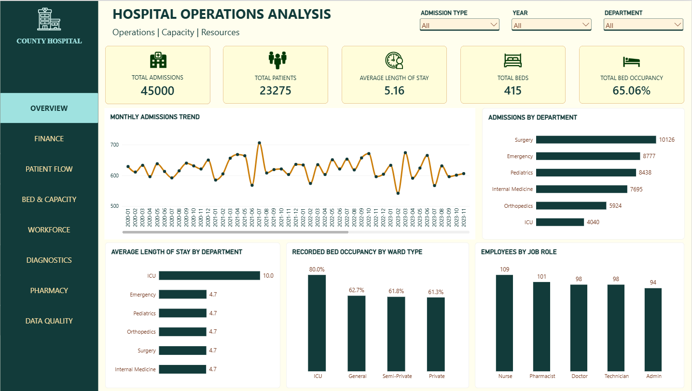

# Hospital Operations & Resource Management Analytics
### I turned 19 interconnected hospital datasets into meaningful insights for smarter operational decisions.
## Project Overview

This project explores hospital operations using 19 interconnected tables from a synthetic healthcare dataset.

The aim was to bring together information on patient admissions, bed capacity, workforce, diagnostic services, pharmacy operations and billing to understand how the hospital was operating.

I used MySQL to audit, clean and analyse the data, then built an interactive Power BI dashboard to present the findings.

## Business Problem

The hospital data was spread across multiple related tables, making it difficult to get a clear view of operational performance.

Before building the dashboard, I needed to check the quality of the data, validate relationships between tables and investigate inconsistencies that could affect reporting.

The project focused on turning the available data into clear, useful information while documenting its limitations.

## Project Objectives

* Analyse patient admissions and length of stay.

* Examine bed availability and recorded occupancy.

* Explore workforce distribution by role, department and employment type.

* Understand diagnostic activity and recorded test results.

* Review prescription activity and identify drugs flagged as low stock.

* Analyse billing totals, payment status and payment methods.

* Identify data-quality issues and explain how they affect reporting.

## Tools and Technologies Used

**MySQL :** Data loading, auditing, cleaning, validation and analysis.

**SQL :** Joins, aggregations, subqueries and KPI calculations.

**Power BI :** Data modelling, DAX measures, interactive visuals and dashboard navigation.

**Excel :** Supporting documentation and the data dictionary.

## Key Findings

* There are 45,000 admissions across 23,275 unique patients.

* There is 65.06% recorded bed occupancy, with 270 occupied beds out of 415.

* There are 500 employees across different job roles and departments.

* There are 63,269 diagnostic records, covering pathology and radiology.

* There are 73,109 prescriptions and 44 drugs are flagged as low stock.

* The recorded billing totals is £1.684 billion, with 22,670 of the total bills marked as pending.

## Data Quality

The data quality audit identified two important issues:

* **Admission dates:** 1,630 admissions had a patient date of birth later than the admission date, affecting 1,007 patients.

* **Billing reconciliation:** 44,998 of 45,000 bills did not match the sum of their associated billing-detail records.

The billing header totals were used for financial KPIs because the detailed records did not consistently reconcile. These discrepancies were documented rather than silently corrected.

The dataset is synthetic and does not represent real patient records. Findings describe the supplied dataset and should not be treated as evidence of actual hospital performance.

## Business Recommendations

The analysis highlighted a few areas where the hospital could improve its monitoring and data management.

#### **1. Take a closer look at the billing differences**

Almost all bills had totals that did not match the sum of their billing details. Before relying on the individual charge records for financial reporting, I would recommend investigating these differences to understand where they come from and ensure the figures can be trusted.

#### **2. Find out why so many bills are still pending**

Out of 45,000 bills, 22,670 were marked as pending. The next step would be to review these outstanding payments, identify any common reasons for the delays, and make it easier for the finance team to follow up.

#### **3. Keep a closer eye on medicine stock levels**

The analysis identified 44 medicines with low stock. Regular stock reviews and clear reorder thresholds could help the pharmacy team spot shortages earlier and plan replenishment more effectively.

#### **4. Improve the accuracy of patient admission records**

There were 1,630 admissions where the patient's date of birth was later than the admission date. These records should be checked and corrected where necessary. Adding simple validation checks could also help prevent similar errors from entering the system in the future.

#### **5. Use bed occupancy figures alongside admission demand**

The recorded bed occupancy rate was 65.06% across 415 beds. Rather than relying on this figure alone, hospital managers should review occupancy by ward type and compare it with admission patterns before making decisions about bed capacity or staffing.

### **Final note**

These recommendations are based on a synthetic dataset, so they highlight areas worth investigating rather than proving what is happening in a real hospital. Further checks would be needed to understand the causes of the issues and decide which actions would have the greatest impact.

## Power BI Dashboard

The dashboard report contains eight pages which are:

1. Hospital Operations Overview

2. Hospital Finance & Data Quality

3. Patient Flow & Admissions

4. Bed & Capacity

5. Workforce

6. Diagnostics

7. Pharmacy

8. Data Quality

## Power BI Dashboard Preview

The dashboard contains eight pages covering hospital operations, finance, patient flow, capacity, workforce, diagnostics, pharmacy and data quality.

### Hospital Operations Overview

**Explore all dashboard pages:** [View the dashboard screenshots](powerbi/screenshots/)

**Download the Power BI report:** [Hospital_Operations_Dashboard.pbix](powerbi/Hospital_Operations_Dashboard.pbix)

*Note: An interactive public Power BI link is not currently available because public embedding is disabled for this account.*

## Project Structure

The repository will contain the SQL scripts, Power BI report, dashboard screenshots, dataset information and supporting documentation.

## Skills Demonstrated

SQL data analysis, data-quality auditing, relational data validation, data cleaning, KPI development, Power BI modelling, DAX, dashboard design and communicating findings to non-technical audiences.
